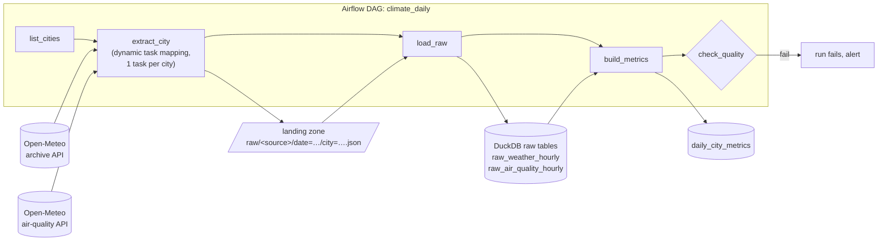

# Climate & Air-Quality ELT with Apache Airflow

[](https://github.com/kaajjalchoudhary/climate-elt-airflow/actions/workflows/ci.yml)


A daily, production-style ELT pipeline orchestrated with **Apache Airflow 3**. It collects hourly
weather and air-quality observations for six cities from the free [Open-Meteo](https://open-meteo.com/)
APIs, lands the raw responses in a replayable landing zone, loads them into **DuckDB**, builds a
daily mart and blocks the run if any data quality check fails.

## Architecture



| Task | What it does |
|---|---|
| `list_cities` | Emits the city list; drives dynamic task mapping |
| `extract_city` | One mapped task per city (`max_active_tis_per_dag=4`). Calls both APIs with retries and exponential backoff, and writes raw JSON atomically (temp file + rename) |
| `load_raw` | Rebuilds that day's rows in the raw tables from the landing zone inside one transaction |
| `build_metrics` | Rebuilds the day in `daily_city_metrics`: temperature, humidity, precipitation, wind, PM2.5/PM10/NO₂, hours above the WHO PM2.5 guideline and the EPA AQI category |
| `check_quality` | 24 hours per city per source, unique keys, every city present, plausible temperatures, non-negative particulates, null ratio under 10% |

## Real output

From the CI run that executes the DAG end to end with `airflow dags test` against the live API
(logical date 2024-06-08, so it processes 2024-06-01):

```
daily_city_metrics for 2024-06-01
│   city    │ avg_temp_c │ max_temp_c │ total_precip_mm │ avg_pm2_5 │ hours_pm25_above_who │ pm25_aqi_category              │
│ delhi     │      37.35 │       44.0 │             0.0 │     43.30 │                   24 │ unhealthy_for_sensitive_groups │
│ dubai     │      34.20 │       41.8 │             0.0 │     39.28 │                   24 │ unhealthy_for_sensitive_groups │
│ singapore │      25.63 │       27.9 │            22.5 │     13.64 │                    7 │ moderate                       │
│ new_york  │      20.42 │       28.2 │             0.0 │      8.43 │                    0 │ good                           │
│ london    │      13.19 │       16.5 │             0.0 │      8.14 │                    0 │ good                           │
│ sydney    │      13.30 │       16.6 │            58.8 │      7.50 │                    0 │ good                           │
```

Delhi and Dubai stayed above the WHO 24-hour PM2.5 guideline (15 µg/m³) for every hour of the day.

## Design decisions

- **Idempotent by construction.** Every step replaces exactly one day (`DELETE` + `INSERT` in a single
  transaction), so retries, reruns and backfills never duplicate data.
- **Replayable landing zone.** Raw API responses are stored before anything is parsed. A bug in the
  transform can be fixed and the day rebuilt without calling the API again.
- **Dynamic task mapping.** Adding a city is a config change; Airflow fans out one extract task per city
  and retries failures per city instead of per run.
- **Data lag built into the schedule.** The reanalysis archive is published with a delay, so each run
  processes the day `DATA_LAG_DAYS` (7) before its logical date.
- **Uniqueness enforced as a quality check, not a primary key.** DuckDB checks constraints eagerly, so
  deleting and re-inserting the same keys inside one transaction fails. CI caught this on the first
  push; dropping the PK and adding a `unique_key` check kept the day-level replace atomic.
- **Thin DAG, testable core.** All logic lives in the `climate_elt` package and runs with or without
  Airflow; the DAG only wires tasks together.

## Running it

**Without Airflow** (fastest way to try it):

```bash
python -m venv .venv && source .venv/bin/activate
make install
make run DATE=2024-06-01 DAYS=7    # backfill a week
make report
```

**With Airflow** (local standalone instance in Docker):

```bash
make airflow-up        # UI on http://localhost:8080, password in `docker compose logs airflow`
```

Then trigger `climate_daily`, or backfill from the CLI inside the container, e.g.
`airflow backfill create --dag-id climate_daily --from-date 2024-06-08 --to-date 2024-06-14`.

## Testing and CI

| Job | What runs |
|---|---|
| `unit` | `ruff` + 11 offline tests that use a fake Open-Meteo client: extraction, atomic writes, idempotent loads, mart math, and every data quality failure mode |
| `airflow` | Installs Airflow 3.1 with the official constraints file, runs DAG integrity tests (`DagBag` import errors, task graph, retries), then runs the whole DAG with `airflow dags test` against the live API and asserts all six cities reached the mart |

The workflow also runs weekly on a schedule, so API or dependency drift shows up quickly.

## Project structure

```
├── dags/climate_daily.py        # Airflow 3 TaskFlow DAG (thin orchestration layer)
├── src/climate_elt/
│   ├── config.py                # cities, variables, sources, paths
│   ├── extract.py               # API client with retries, atomic raw writes
│   ├── load.py                  # landing zone -> DuckDB raw tables
│   ├── transform.py             # daily_city_metrics mart
│   ├── quality.py               # data quality checks
│   ├── pipeline.py              # Airflow-free runner / backfill CLI
│   └── report.py                # print the mart
├── tests/                       # offline unit tests + DAG integrity tests
├── docker-compose.yml           # local Airflow standalone
└── .github/workflows/ci.yml
```

## Next steps

- Swap DuckDB for a cloud warehouse (BigQuery / Snowflake) via an Airflow connection
- Store the landing zone in object storage (S3 / GCS) using Airflow's ObjectStoragePath
- Publish `daily_city_metrics` as an Airflow Asset to trigger downstream DAGs

## License

MIT, see [LICENSE](LICENSE).
